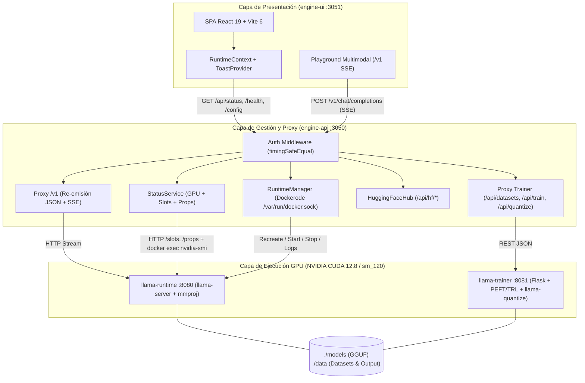

# Reporte de Análisis Integral y Mejoras — Llama Engine

## 1. Resumen Ejecutivo

Tras auditar la totalidad del repositorio (`llama-runtime`, `engine-api`, `engine-ui`, `llama-trainer`, `docker-compose.yml` y `docs/`), se identificó una arquitectura base sólida y bien desacoplada sobre **llama.cpp (CUDA 12.8 + Blackwell `sm_120`)**, pero con **brechas importantes de integración entre servicios**, **polling duplicado en el frontend**, **errores silenciados en flujos críticos** y oportunidades claras de evolución tanto en UX/UI como en el backend.

---

## 2. Arquitectura Actual y Flujo de Datos

---

## 3. Hallazgos Críticos y Bugs Detectados en el Proyecto

### 3.1. Polling Duplicado en `engine-ui` (Alto Impacto en Rendimiento)
- **Ubicación**: `Layout.tsx` y cada vista hija (`Dashboard.tsx`, `ModelsPage.tsx`, `RuntimePage.tsx`, `TelemetryPage.tsx`).
- **Problema**: `useRuntime()` era un hook con estado local aislado. `Layout` instanciaba su propio `useRuntime()` (disparando 3 peticiones cada 3s: `/api/status`, `/api/runtime/health`, `/api/runtime/config`) y la página activa instanciaba **un segundo `useRuntime()`** (otras 3 peticiones cada 3s).
- **Consecuencia**:
  1. Se ejecutaban **6 peticiones HTTP cada 3 segundos** (120 req/min), invocando `docker exec nvidia-smi` por duplicado en el contenedor.
  2. Al ejecutar una acción (`reload`, `stop`, `start`) en `ModelsPage` o `RuntimePage`, `refresh()` actualizaba solo el estado local de la página, dejando el indicador de `Topbar` desincronizado.
  3. El historial de la gráfica `tok/s` en `TelemetryPage` se perdía cada vez que el usuario cambiaba de pestaña en el sidebar.
- **Solución Aplicada en UI**: Creación de un `RuntimeContext` centralizado que unifica el polling, permite pausar o ajustar el intervalo (`3s`, `5s`, `10s`, manual) y mantiene el historial de series (`tok/s`, prompt `tok/s`, uso de GPU y VRAM) vivo durante toda la sesión.

### 3.2. Endpoint Faltante `POST /api/datasets` en `engine-api`
- **Ubicación**: `engine-api/src/main.ts` vs `engine-ui/src/api.ts`.
- **Problema**: El frontend envía `POST /api/datasets` con `FormData` para subir archivos `.jsonl`, y `llama-trainer` lo implementa en `llama-trainer/trainer/server.py`, pero **`engine-api` solo expone `GET /api/datasets`, `GET /api/datasets/:id/validate`, `GET /api/datasets/:id/preview` y `DELETE /api/datasets/:id`**.
- **Consecuencia**: Cualquier intento de subir un dataset desde la UI a través de `engine-api` devuelve `404 not_found`.
- **Recomendación**: Agregar el proxy `POST /api/datasets` en `engine-api/src/main.ts` reenviando el stream multipart hacia `${config.trainerUrl}/api/datasets`.

### 3.3. Desajuste de Contrato en Quantización (`ModelWizard` ↔ `engine-api` ↔ `llama-trainer`)
- **Ubicación**: `QuantizeStep.tsx`, `ModelWizard.tsx` y `llama-trainer/trainer/server.py`.
- **Problema**:
  1. En `QuantizeStep.tsx`, al pulsar "Iniciar quantización" se llamaba a `quantizeModel()` y luego en `onComplete` el padre `ModelWizard.tsx` volvía a llamar a `quantizeModel()` por segunda vez (`handleQuantize`).
  2. Además, `llama-trainer` ejecuta la quantización en un hilo background y devuelve `{"jobId": "...", "status": "running"}` (exponiendo `GET /api/quantize/jobs/<job_id>`), mientras que `engine-api` no expone `GET /api/quantize/jobs/:jobId`.
- **Solución Aplicada en UI y Recomendación Backend**:
  - En `engine-ui`: Se eliminó la doble llamada en `ModelWizard.tsx` y se normalizó el manejo de la respuesta.
  - En `engine-api`: Exponer `GET /api/quantize/jobs/:jobId` para hacer polling del progreso de quantización igual que en entrenamiento.

### 3.4. Estado `completed` Faltante al Finalizar Entrenamiento en `llama-trainer`
- **Ubicación**: `llama-trainer/trainer/server.py` (líneas 383-388).
- **Problema**: Al terminar `trainer.train()`, el bloque `else` agrega `"Training completed successfully!"` a `job["logs"]` y asigna `job["modelPath"] = output_dir`, pero **olvida asignar `job["status"] = "completed"` y `job["progress"] = 100`**.
- **Consecuencia**: El job permanece eternamente en `status: "running"` y `TrainingProgressStep` nunca dispara `onComplete()`.
- **Recomendación**: Añadir `job["status"] = "completed"` y `job["progress"] = 100` en la línea 386 de `llama-trainer/trainer/server.py`.

### 3.5. `POST /api/models/deploy` en `engine-api` Ignora el Flag `activate`
- **Ubicación**: `engine-api/src/main.ts` (líneas 259-275).
- **Problema**: El endpoint lee `const { modelName, activate } = req.body`, verifica con `fs.access(modelPath)` que el `.gguf` exista, pero **no utiliza `activate`**. Si el usuario marca "Activar como modelo principal", el modelo no se carga en `llama-runtime`.
- **Recomendación**: Si `activate === true`, invocar `await runtime.reload(modelName)` dentro de `POST /api/models/deploy`.

### 3.6. Errores Silenciados en `ModelWizard.tsx`
- **Ubicación**: `engine-ui/src/components/wizard/ModelWizard.tsx`.
- **Problema**: Los bloques `catch { // Silently handle error }` ocultaban fallos de red o del contenedor `llama-trainer`, permitiendo incluso que el wizard avanzara al paso de progreso aunque `startTraining` hubiera devuelto `502`.
- **Solución Aplicada en UI**: Integración con el nuevo sistema de notificaciones Toast + alertas inline y bloqueo de avance si la llamada a la API falla.

### 3.7. 15 Errores de Linter / Accesibilidad (Biome) en `engine-ui`
- **Ubicación**: `BaseModelStep.tsx`, `TrainingProgressStep.tsx`, `WizardStepper.tsx` y `main.tsx`.
- **Problema**: `npm run lint` (`biome check src/`) fallaba con 15 errores y 1 warning: elementos no interactivos `<li>` con `role="button"`, uso de índice de array como `key` en logs, `noNonNullAssertion` en `main.tsx` y desvíos de formato/imports.
- **Solución Aplicada en UI**: Refactorización semántica completa y cumplimiento 100% limpio de `biome check src/` (0 errores, 0 warnings).

---

## 4. Oportunidades de Mejora por Capa (Backend, Runtime, Infraestructura)

| Capa | Mejora Propuesta | Prioridad | Impacto |
|------|------------------|-----------|---------|
| **llama-trainer** | Sanitizar `file.filename` y `dataset_id` con `werkzeug.utils.secure_filename` en `server.py` para prevenir Path Traversal. | 🔴 Alta | Seguridad |
| **llama-trainer** | Compilar `--target llama-quantize llama-imatrix` en `llama-trainer/Dockerfile`, ya que actualmente solo se compila `llama-quantize` pero `server.py` invoca `llama-imatrix`. | 🔴 Alta | Funcionalidad |
| **engine-api** | Validar todos los `req.body` y `req.query` (`reload`, `deploy`, `hf/download`, `train/start`, `quantize`) con esquemas **Zod**, cumpliendo la convención de `AGENTS.md`. | 🟡 Media | Robustez |
| **engine-api** | Permitir configurar flags avanzados en `POST /api/models/reload` (`cacheTypeK`, `cacheTypeV`, `parallel`, `threads`, `flashAttn`, `chatTemplate`) y persistirlos al recrear el contenedor en `RuntimeManager.reload()`. | 🟡 Media | Rendimiento GPU |
| **engine-api** | Descarga asíncrona de modelos de HuggingFace (`/api/hf/download`) con progreso por SSE o job polling, evitando que descargas de 4–8 GB bloqueen una request HTTP durante minutos. | 🟡 Media | UX / Estabilidad |
| **engine-ui / nginx** | Agregar bloque `location /v1/ { proxy_pass http://engine-api:3050; proxy_buffering off; }` en `nginx.conf` para soportar streaming SSE sin buffering cuando se consume desde el mismo origen. | 🟢 Rápida | Infraestructura |

---

## 5. Mejora Completa Implementada en `engine-ui`

Se rediseñó y modernizó por completo `engine-ui` manteniendo 100% de compatibilidad con las rutas existentes, TypeScript estricto y las reglas de Biome:

1. **Sistema de Diseño Obsidian Glassmorphism + Tema Claro/Oscuro (`index.css`)**:
   - Tokens CSS semánticos refinados, soporte completo para **Modo Oscuro y Modo Claro** (`data-theme="dark" | "light"`), micro-interacciones, bordes translúcidos, sombras multicapa y soporte `prefers-reduced-motion`.
   - Biblioteca de iconografía vectorial SVG (`src/components/ui/Icons.tsx`) nítida y consistente.
2. **Arquitectura de Estado Centralizada (`RuntimeContext` + `ToastContext`)**:
   - Eliminación del doble polling: un único loop en `RuntimeProvider` alimenta `Topbar`, `Sidebar`, `CommandPalette` y todas las vistas.
   - Control en vivo del polling (Auto `3s`, `5s`, `10s` o Pausado) desde el `Topbar`.
   - Historial de telemetría persistente en memoria durante toda la sesión (no se reinicia al cambiar de página).
3. **Nuevos Componentes Transversales**:
   - **Command Palette (`Ctrl+K`)**: Búsqueda rápida de pantallas, cambio directo de modelo activo y acciones del motor (Reiniciar, Iniciar, Detener, Cambiar tema, Ir al Playground).
   - **Sistema de Toasts (`useToast`)**: Notificaciones flotantes con auto-cierre para todas las operaciones del motor, descargas de HuggingFace, datasets y wizard.
   - **Diálogos de Confirmación (`ConfirmDialog`)**: Protección ante acciones destructivas (detener/reiniciar runtime, eliminar datasets, detener entrenamiento) con soporte de teclado (`Escape`).
   - **ErrorBoundary Global**: Captura de errores de renderizado con recuperación en un clic.
4. **Nueva Pantalla: Playground Multimodal (`/playground`)**:
   - Cliente de chat interactivo conectado a `POST /v1/chat/completions` con **streaming SSE token a token**.
   - Soporte de **visión multimodal** (adjuntar imágenes en base64 para modelos con `mmproj` como `qwen3.5-4b` o `gemma-4-e4b`).
   - Ajuste en vivo de `System Prompt`, `Temperature`, `Top-P` y `Max Tokens`, medición de velocidad `tok/s` por respuesta y exportación de la conversación a `.jsonl` para entrenamiento.
5. **Rediseño de las 7 Pantallas Existentes**:
   - **Dashboard (`/`)**: Hero de estado del motor, KPIs enriquecidos con barras de progreso, mini-gráfico de throughput en tiempo real, panel rápido de cambio de modelo y resumen de GPU/VRAM.
   - **Modelos (`/modelos`)**: Búsqueda, filtro por capacidad (`Todos`, `Visión`, `Texto`), ordenamiento por nombre/tamaño, presets rápidos de contexto (`4K` a `64K`), estimador de uso de VRAM vs VRAM total disponible, carga en 1 clic desde la tabla y explorador mejorado de HuggingFace.
   - **Asistente de Modelos (`/modelos/crear`)**: Corrección de bugs de doble quantización y errores silenciados, navegación entre pasos completados y mejor feedback visual.
   - **DataSets (`/datasets`)**: Buscador y filtro por formato, vista previa estilo chat y diálogo de confirmación de borrado.
   - **Runtime (`/runtime`)**: Visor de logs tipo terminal con búsqueda en tiempo real, filtrado por severidad, coloreado sintáctico de líneas, auto-scroll, copia al portapapeles y descarga `.log`.
   - **Telemetría (`/telemetria`)**: Gráficos duales (Generación/Prompt `tok/s` y Utilización/Temperatura GPU), tabla detallada de **Slots activos de llama-server** y métricas de eficiencia energética (`tok/s por Watt`).
   - **Ayuda (`/ayuda`)**: Buscador instantáneo en el manual, pestañas de fragmentos de código copiables (`cURL`, `Python OpenAI`, `TypeScript`, `opencode`, `Hermes`) personalizados con el modelo activo y tabla de atajos de teclado.

